# Custom trains and skylines

[git-trains](../README.md)

## Make your own train (by hand or with AI)

Any train fits in a small JSON file: colors, stripes, doors, and the front drawn row by row. You don't need to code.

**By hand, in the [studio](https://cracksmity.github.io/git-trains/studio/):** start from any model, change every color and stripe in a form, draw the nose (or a whole steam locomotive) pixel by pixel, over a photo if you like, and watch the scene and the calendar mini update as you go. Download the JSON, or copy a link that carries the whole train to share it.

**With AI:** an AI writes it from a photo or a description:

1. Paste [docs/ai/train.md](ai/train.md) into your AI chat (Claude, ChatGPT, Gemini...) and, at the end, describe your train or attach a photo.
2. Save the JSON it gives you in your profile repository, for example as `.github/train.json`.
3. In the workflow, use `train: .github/train.json`.

```yaml
      - uses: Cracksmity/git-trains@3b431f93872507bc915be9f20e8b84ed104fdbe8 # v1.1.2
        with:
          train: .github/train.json
          skyline: new-york
```

Prefer one command? [Design from your terminal](#design-from-your-terminal) runs your AI CLI and the validator for you, retries included.

If something doesn't add up (a mistyped color, an extra row), the Action stops and lists **every** problem in the log; paste them back to the AI so it fixes them. In the [playground](https://cracksmity.github.io/git-trains/preview/) (or locally with `npm run preview`) you can paste the JSON and see it right away, with the same messages.



Examples in [examples/trains](../examples/trains): New York's R160 subway cars, Osaka Metro's 400 series, the Medellín Metro CAF train (from a [benchmark of ten AI runs](https://cracksmity.github.io/git-trains/benchmarks/medellin/) given the same guides and photos) and a steam tank engine. The format uses the same keys as [src/trains/models.js](../src/trains/models.js), so a train people love can join the catalog as is. The file is only read as data: nothing in it runs, and every color and size is checked before drawing.

**Steam trains.** With `loco` instead of `nose`, the train gets a locomotive up front: its own 30-row drawing, with the chimney and dome rising above the cars, driving wheels joined by a moving coupling rod, and smoke that puffs faster the faster it goes. The cars follow behind and the last one ends in a flat tail with a red lamp.


## City skylines

There's a city behind the train. By default it's procedural and seeded with your username, so it's yours alone and stays the same every day; with `skyline: .github/skyline.json` it's the city you want. Two come built in:

| `skyline` | What you see |
| --- | --- |
| `new-york` | One World Trade Center, Empire State, Chrysler, the Brooklyn Bridge and the Statue of Liberty |
| `osaka` | Shitennō-ji pagoda, the Ferris wheel, Tsutenkaku, Abeno Harukas, the Umeda Sky Building, a cable-stayed bridge and the castle |

A skyline is a list of pixel-art buildings, **without too much detail**: each one is a block with a top (stepped, spire, antenna, dome, pyramid) or a row-by-row drawing for landmarks with their own shape. It has no colors of its own: it uses the theme's, so it switches between light and dark by itself and the windows light up at night. To make yours, paste [docs/ai/skyline.md](ai/skyline.md) into your AI with the city you want or a photo. Examples in [examples/skylines](../examples/skylines) (Mexico City, Medellín, Guadalajara, Malmö).


### The countryside of a region

Between the tracks of `mode: multi` there is a strip of countryside (a village and a forest), and in every mode a slope of bushes in front of the city. By default it is the same houses, pines and round trees everywhere. A skyline can bring its own: add a `region` block and Osaka shows Japanese farmhouses, cherry trees and a torii, while Guadalajara shows adobe houses, blue agave and jacarandas, with the Tequila volcano on the horizon.





A `region` holds small pixel drawings (`houses`, `trees`, `plants` and one `landmark`, written row by row like the buildings), a `terrain` behind them (`hills`, `mountains`, `plains` or `sea`) and up to four `accents`: extra colors with a light and a dark value each, so they follow the theme like everything else. Without a `region` the countryside is exactly what it was. `osaka` and `new-york` come with theirs, and so do the examples for Mexico City, Medellín, Guadalajara and Malmö. To research and draw yours, paste [docs/ai/region.md](ai/region.md) into your AI along with your city (and your skyline JSON, if you already have one). `node scripts/region-sheet.js examples/skylines/guadalajara.json sheet.png` draws the pieces zoomed in, by day and at night.
## Design from your terminal

Already use Codex, Antigravity or Claude Code? Let it do the whole loop for you: it writes the JSON, the validator checks it, and any problems go back to the AI until it passes.

```bash
npx github:Cracksmity/git-trains design train "Osaka Metro 400 series" --photo train.jpg
npx github:Cracksmity/git-trains design skyline "Lisbon"
```

From a clone, `node bin/git-trains.js design ...` does the same. It needs Node 24 and one of these CLIs installed and signed in (it uses your own subscription, nothing else to sign up for): `codex`, `agy` (Antigravity) or `claude`. By default it takes the first one that answers `--version`, in that order.

What happens:

1. It builds a prompt from the AI guide ([train](ai/train.md) or [skyline](ai/skyline.md)) plus your description and photos.
2. It runs the CLI headless in an empty temporary working folder: Codex uses its read-only sandbox, Claude Code is configured with only the Read tool (for photos), and Antigravity has a hook that rejects non-read tools. The working folder and tool settings do not confine filesystem reads; the CLI may access files readable by your account. Prompts and supplied photos are sent to the selected AI provider. Review the provider and CLI permissions before using sensitive data.
3. It pulls the JSON out of the answer and checks it with the same validator as the Action. If there are problems, the list goes back to the AI for another try, up to `--tries`.
4. When it passes, it writes `.github/train.json` (or `.github/skyline.json`), draws a small picture in the terminal (half-block characters, in a truecolor terminal) and prints a [studio](https://cracksmity.github.io/git-trains/studio/) link that carries the whole file, so you can tweak it by hand.

| Option | Meaning |
| --- | --- |
| `--photo <file>` | A photo to design from (png, jpg, webp, gif; up to 20 MB). Repeat it for several. |
| `--ai codex\|gemini\|claude` | Which CLI to use (`gemini` runs `agy`). Default: the first one installed. |
| `--model <slug>` | The model for that CLI, for example `gpt-6.1-terra`. Default: the CLI's own. |
| `--out <file>` | Where to write it. Default `.github/train.json` or `.github/skyline.json`. |
| `--tries <n>` | Attempts, each one fed the validator's problems. Default 3. |
| `--force` | Replace `--out` if it exists. Without it, an existing file is never overwritten. |
| `--no-preview` | Skip the picture in the terminal. |

If no try passes, nothing is written to `--out`: the last answer is saved next to it as `<out>.draft` and the remaining problems are printed, ready to paste back to an AI, open in the studio or retry with more `--tries`. Every try is a full AI run, and strong models can think for several minutes, so a run can take a while.
## Share your city

The [community depot](../community/README.md) collects trains and skylines drawn by people from their own cities: your metro, the tram you take to work, the skyline outside your window. Browse them in the [gallery](https://cracksmity.github.io/git-trains/gallery/), open any of them in the studio to make it yours, or download its JSON and use it as `train: .github/train.json` or `skyline: .github/skyline.json`.

To add yours:

1. Draw it with AI as above and check it in the [playground](https://cracksmity.github.io/git-trains/preview/#yours).
2. Add `"author"` (your GitHub username) and a `"description"` of the real train or city, and save it as `community/trains/<id>.json` (the file name is its `id`) or `community/skylines/<city>.json`.
3. Open a pull request, one train or skyline per pull request. A check validates it the way the Action does, draws a preview in light and dark (plus the mini train from calendar mode) and comments with it. Once it's merged, it shows up in the gallery.

The rules are short: no logos or lettering, a description of the real train or city, one per pull request. They're in [community/README.md](../community/README.md). No time to draw it? [Request a city or train](https://github.com/Cracksmity/git-trains/issues/new?template=city-request.yml) and someone else can pick it up.
