# Trenes y skylines personalizados

[git-trains](../../README.es.md)

## Haz tu propio tren (a mano o con IA)

Cualquier tren cabe en un JSON pequeño: colores, franjas, puertas y el frente dibujado fila por fila. No necesitas programar.

**A mano, en el [estudio](https://cracksmity.github.io/git-trains/studio/):** parte de cualquier modelo, cambia cada color y franja en un formulario, dibuja la trompa (o una locomotora de vapor completa) píxel por píxel, sobre una foto si quieres, y mira cómo se actualizan la escena y la miniatura del calendario. Descarga el JSON o copia un link que lleva el tren completo para compartirlo.

**Con IA:** una IA lo escribe a partir de una foto o una descripción:

1. Pega [docs/ai/train.md](../ai/train.md) en el chat de tu IA (Claude, ChatGPT, Gemini...) y, al final, describe tu tren o adjunta una foto. Las instrucciones están en inglés, pero puedes hablarle en español.
2. Guarda el JSON que te dé en tu repositorio de perfil, por ejemplo como `.github/train.json`.
3. En el workflow usa `train: .github/train.json`.

```yaml
      - uses: Cracksmity/git-trains@3b431f93872507bc915be9f20e8b84ed104fdbe8 # v1.1.2
        with:
          train: .github/train.json
          skyline: new-york
          language: es
```

¿Prefieres un solo comando? [Diseña desde la terminal](#diseña-desde-la-terminal) ejecuta tu CLI de IA y el validador por ti, con reintentos incluidos.

Si algo no cuadra (un color mal escrito, una fila de más), la Action se detiene y lista **todos** los problemas en el log; pégaselos a la IA para que los corrija. En el [playground](https://cracksmity.github.io/git-trains/preview/) (o localmente con `npm run preview`) puedes pegar el JSON y verlo al instante, con los mismos mensajes.



Ejemplos en [examples/trains](../../examples/trains): los R160 del metro de Nueva York, la serie 400 del Metro de Osaka, el tren CAF del Metro de Medellín (salió de una [comparativa de diez corridas de IA](https://cracksmity.github.io/git-trains/benchmarks/medellin/) con las mismas guías y fotos) y una locomotora tanque de vapor. El formato usa las mismas claves que [src/trains/models.js](../../src/trains/models.js), así que un tren que guste puede entrar al catálogo tal cual. El archivo solo se lee como datos: nada en él se ejecuta, y cada color y medida se revisa antes de dibujar.

**Trenes de vapor.** Con `loco` en vez de `nose`, el tren lleva una locomotora al frente: su propio dibujo de 30 filas, con la chimenea y el domo por encima de los vagones, ruedas motrices unidas por una biela que se mueve y humo que sale más seguido cuanto más rápido va. Los vagones van detrás y el último termina en una cola plana con farol rojo.


## Skylines de ciudades

Detrás del tren hay una ciudad. Por defecto se genera a partir de tu usuario: es solo tuya y es la misma todos los días. Con `skyline: .github/skyline.json` es la ciudad que quieras. Vienen dos incluidas:

| `skyline` | Lo que se ve |
| --- | --- |
| `new-york` | One World Trade Center, Empire State, Chrysler, el puente de Brooklyn y la Estatua de la Libertad |
| `osaka` | La pagoda de Shitennō-ji, la rueda de la fortuna, Tsutenkaku, Abeno Harukas, el Umeda Sky Building, un puente atirantado y el castillo |

Un skyline es una lista de edificios en pixel art, **sin demasiado detalle**: cada uno es un bloque con un remate (escalonado, aguja, antena, cúpula, pirámide) o un dibujo fila por fila para los monumentos con forma propia. No tiene colores propios: usa los del tema, así que cambia solo entre claro y oscuro y de noche se encienden las ventanas. Para hacer el tuyo, pega [docs/ai/skyline.md](../ai/skyline.md) en tu IA con la ciudad que quieres o una foto. Ejemplos en [examples/skylines](../../examples/skylines) (Ciudad de México, Medellín, Guadalajara, Malmö).



### El campo de una región

Entre las vías del `mode: multi` hay una franja de campo (un pueblo y un bosque) y, en todos los modos, un talud con arbustos delante de la ciudad. Por defecto son las mismas casas, pinos y árboles redondos en todas partes. Un skyline puede traer los suyos: añade un bloque `region` y Osaka muestra casas de labranza japonesas, cerezos y un torii, mientras que Guadalajara muestra casas de adobe, agaves azules y jacarandas, con el volcán de Tequila en el horizonte.





Una `region` contiene pequeños dibujos en píxeles (`houses`, `trees`, `plants` y un `landmark`, escritos fila por fila como los edificios), un `terrain` detrás (`hills`, `mountains`, `plains` o `sea`) y hasta cuatro `accents`: colores extra con un valor claro y uno oscuro, así que siguen el tema como todo lo demás. Sin `region` el campo es exactamente el de siempre. `osaka` y `new-york` traen el suyo, y también los ejemplos de Ciudad de México, Medellín, Guadalajara y Malmö. Para investigar y dibujar el tuyo, pega [docs/ai/region.md](../ai/region.md) en tu IA junto con tu ciudad (y el JSON de tu skyline, si ya lo tienes). `node scripts/region-sheet.js examples/skylines/guadalajara.json hoja.png` dibuja las piezas ampliadas, de día y de noche.
## Diseña desde la terminal

¿Ya usas Codex, Antigravity o Claude Code? Deja que haga todo el ciclo por ti: escribe el JSON, el validador lo revisa y los problemas vuelven a la IA hasta que pasa.

```bash
npx github:Cracksmity/git-trains design train "Osaka Metro 400 series" --photo tren.jpg
npx github:Cracksmity/git-trains design skyline "Lisboa"
```

Desde un clon, `node bin/git-trains.js design ...` hace lo mismo. Necesita Node 24 y una de estas CLI instalada y con sesión iniciada (usa tu propia suscripción, no hay que registrarse en nada más): `codex`, `agy` (Antigravity) o `claude`. Por defecto toma la primera que responda a `--version`, en ese orden.

Qué pasa:

1. Arma un prompt con la guía para IA ([tren](../ai/train.md) o [skyline](../ai/skyline.md)) más tu descripción y tus fotos.
2. Ejecuta la CLI sin interfaz en una carpeta de trabajo temporal vacía: Codex usa su sandbox de solo lectura, Claude Code se configura solo con la herramienta Read (para fotos) y Antigravity tiene un hook que rechaza herramientas que no sean de lectura. La carpeta de trabajo y la configuración de herramientas no restringen las lecturas del sistema de archivos; la CLI puede acceder a archivos que tu cuenta pueda leer. Los prompts y las fotos proporcionadas se envían al proveedor de IA elegido. Revisa los permisos de la CLI y del proveedor antes de usar datos sensibles.
3. Saca el JSON de la respuesta y lo revisa con el mismo validador que la Action. Si hay problemas, la lista vuelve a la IA para otro intento, hasta `--tries`.
4. Cuando pasa, escribe `.github/train.json` (o `.github/skyline.json`), dibuja una imagen pequeña en la terminal (caracteres de medio bloque, en una terminal con color verdadero) e imprime un enlace al [estudio](https://cracksmity.github.io/git-trains/studio/) que lleva el archivo completo, para que lo retoques a mano.

| Opción | Qué hace |
| --- | --- |
| `--photo <archivo>` | Una foto de la que partir (png, jpg, webp, gif; hasta 20 MB). Repítela para varias. |
| `--ai codex\|gemini\|claude` | Qué CLI usar (`gemini` ejecuta `agy`). Por defecto, la primera instalada. |
| `--model <slug>` | El modelo de esa CLI, por ejemplo `gpt-6.1-terra`. Por defecto, el de la propia CLI. |
| `--out <archivo>` | Dónde escribirlo. Por defecto `.github/train.json` o `.github/skyline.json`. |
| `--tries <n>` | Intentos, cada uno con los problemas del validador. Por defecto 3. |
| `--force` | Reemplaza `--out` si existe. Sin esto, un archivo existente nunca se sobrescribe. |
| `--no-preview` | Omite la imagen en la terminal. |

Si ningún intento pasa, no se escribe nada en `--out`: la última respuesta queda al lado como `<out>.draft` y se imprimen los problemas que faltan, listos para pegarlos a una IA, abrirlos en el estudio o reintentar con más `--tries`. Cada intento es una ejecución completa de la IA y los modelos fuertes pueden pensar varios minutos, así que una corrida puede tardar.
## Comparte tu ciudad

El [depósito comunitario](../../community/README.md) reúne trenes y skylines que la gente dibuja de sus propias ciudades: tu metro, el tranvía en el que vas al trabajo, el skyline que ves desde tu ventana. Míralos en la [galería](https://cracksmity.github.io/git-trains/gallery/), abre cualquiera en el estudio para hacerlo tuyo, o descarga su JSON y úsalo como `train: .github/train.json` o `skyline: .github/skyline.json`.

Para agregar el tuyo:

1. Dibújalo con IA como arriba y revísalo en el [playground](https://cracksmity.github.io/git-trains/preview/#yours).
2. Agrega `"author"` (tu usuario de GitHub) y una `"description"` del tren o la ciudad real (en inglés, como el resto del depósito), y guárdalo como `community/trains/<id>.json` (el nombre del archivo es su `id`) o `community/skylines/<ciudad>.json`.
3. Abre un pull request, uno por tren o skyline. Una revisión automática lo valida igual que la Action, dibuja una vista previa en claro y oscuro (más el mini tren del modo calendario) y la deja en un comentario. Cuando se fusiona, aparece en la galería.

Las reglas son pocas: nada de logos ni letreros, una descripción del tren o la ciudad real, uno por pull request. Están en [community/README.md](../../community/README.md). ¿No tienes tiempo de dibujarlo? [Pide una ciudad o un tren](https://github.com/Cracksmity/git-trains/issues/new?template=city-request.yml) y alguien más puede tomarlo.
