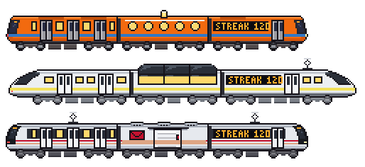

# Guía de uso

[git-trains](../../README.es.md)

## Qué significa cada parte

| Tu actividad | En el tren |
| --- | --- |
| Contribuciones del último año | **Vagones**, de 1 a 6 (50 / 200 / 500 / 1000 / 2000) |
| Lenguaje principal | Una **franja** con el color oficial de ese lenguaje en GitHub |
| Racha actual | El letrero LED **"RACHA 12"** (con `language: es`) y las ventanas encendidas (30 días las prenden todas) |
| Lo que hiciste ayer | **0**: parado con las puertas abiertas · **1-3**: lento · **4-9**: normal · **10+**: rápido, con chispas y líneas de velocidad |
| Esa misma actividad | Un **semáforo** junto a la vía: rojo (0), ámbar (poca) o verde (normal o mucha) |
| Tu usuario | El **letrero de la estación** y una **ciudad propia** generada a partir de tu nombre: no hay dos iguales |

Tu racha no se rompe a primera hora: si hoy todavía no hay actividad, cuenta desde ayer.
## Vagones desbloqueables

Algunos logros añaden un vagón especial a tu tren, justo detrás de la cabina. Solo se muestra uno: el más raro que hayas conseguido.



| Consigues | Vagón | Cómo es |
| --- | --- | --- |
| Más de 500 pull requests | **Vagón postal** | Sin ventanas: una puerta corrediza de carga, un sobre y una franja con el color de tu lenguaje principal |
| Una racha de 100 días | **Vagón comedor** | Ventanas redondas que brillan y una lamparita en el techo |
| Más de 100 estrellas en tus repositorios | **Vagón mirador** | Un techo de cristal elevado y ventanas panorámicas |

Los vagones se dibujan con la paleta del tren al que se unen, y el título de la imagen añade una línea que dice cuál conseguiste. La racha es la actual, así que el vagón comedor se va si la racha se rompe. Un vagón especial cuenta como un vagón más: en un tren de 6 vagones ocupa el lugar del último vagón normal para que el tren siga cabiendo en la escena.

Necesitan los números de tu perfil (estrellas y pull requests), lo que supone una petición más a la API en cada ejecución. Si falla, la Action registra un `::notice::` y dibuja el tren sin ellos. Pon `unlocks: false` para desactivarlos.
## Modo calendario

Con `calendar: true` la Action también escribe un calendario de contribuciones junto al tren. Una versión mini de tu tren recorre las semanas en zigzag, come las celdas con contribuciones y crece hasta tener el mismo largo que el tren de la escena. También funciona con trenes propios y de vapor. La franja, las ventanas y la velocidad siguen tu actividad; el texto muestra tus contribuciones y tu racha. También se aplican `language` y `label`. El calendario sigue el tema elegido y deja el tren estacionado si se prefiere reducir el movimiento.


```yaml
      - uses: Cracksmity/git-trains@3b431f93872507bc915be9f20e8b84ed104fdbe8 # v1.1.2
        with:
          calendar: true
```

Con `theme: both` (el valor por defecto), agrega esto a tu README:

```html
<picture>
  <source media="(prefers-color-scheme: dark)" srcset="../../dist/train-calendar-dark.svg">
  
</picture>
```

La Action también escribe `train-calendar.svg`. Con un solo tema, escribe únicamente ese archivo de calendario. Mira también el [ejemplo de vapor](../example-calendar-steam.svg).
## Resumen del año

Con `year-in-review: true` la Action escribe un póster de un año natural de tu actividad, dibujado como un viaje en tren.



Qué lleva:

- **Tu año en cuatro números:** contribuciones, días activos, la racha más larga (con sus fechas) y el día más activo.
- **Un mapa de la ruta:** una línea de tren con una estación por mes, tan alta como lo activo que fue ese mes (el mes más activo ondea una bandera). Tu tren recorre la línea, el mismo modelo que la escena (`train`: un modelo del catálogo, tu propio JSON o una locomotora de vapor) con tantos vagones como gane el total de ese año, con la franja de tu lenguaje principal. Se detiene en cada estación tanto como lo fue el mes y pasa de largo los meses sin nada. Con movimiento reducido se queda en la última estación.
- **El mes más activo y tus lenguajes principales** de ese año: los lenguajes principales de los repositorios en los que hiciste commits, ordenados por commits (`exclude-languages` se aplica; hasta cuatro).
- **El vagón especial** si lo conseguiste (ver [Vagones desbloqueables](#vagones-desbloqueables)), detrás de la cabina y con una línea que dice cuál. Para el póster se gana con ese año: su racha más larga, más las estrellas y los pull requests de tu perfil.

```yaml
      - uses: Cracksmity/git-trains@3b431f93872507bc915be9f20e8b84ed104fdbe8 # v1.1.2
        with:
          year-in-review: true
          review-year: 2025 # opcional
```

**¿Qué año?** `review-year` acepta un año de 2008 al actual. Vacío es el **año en curso hasta hoy**, salvo en **enero**, cuando el año nuevo apenas empieza y el póster muestra el **año que acaba de terminar**. (UTC, como todo aquí.) Un año en curso cubre los días hasta el día en que corre la Action.

Sigue `theme`, `language` y `border`, y usa los mismos cinco colores que las tarjetas (`color-background`, `color-title`, `color-icon`, `color-text`, `color-ring`): el fondo, los títulos y los números grandes, los rieles y los iconos, el texto y las estaciones. Con el `theme: both` por defecto añade esto a tu README:

```html
<picture>
  <source media="(prefers-color-scheme: dark)" srcset="../../dist/year-in-review-dark.svg">
  
</picture>
```

La Action también escribe `year-in-review.svg` (automático); con un solo tema escribe únicamente ese archivo. Hace una petición más a la API (además de la del perfil que ya usan los vagones desbloqueables). Si falla, la Action registra un `::warning::` y escribe todo lo demás. Con `language: es` sale como [en el ejemplo](../example-year-in-review-es.svg).
## Estaciones y fiestas

La escena sigue el calendario, así que tu perfil se siente vivo todo el año. El día que corre la Action (UTC) añade unos pocos píxeles de decoración en capas propias, detrás del tren, y también se detiene si se prefiere reducir el movimiento:

| Cuándo | Qué lleva la escena |
| --- | --- |
| Invierno (dic – feb) | nieve ligera cayendo, nieve en los techos y en el suelo |
| Primavera (mar – may) | unos pétalos rosas a la deriva |
| Verano (jun – ago) | nada: la escena de siempre |
| Otoño (sep – nov) | hojas naranjas |
| 1 – 30 oct · Hacktoberfest | una calabaza pequeña junto al semáforo |
| 31 oct – 2 nov · Día de Muertos | papel picado color cempasúchil colgado a lo largo de la vía |
| 15 dic – 6 ene · Navidad | luces parpadeantes en el cable |
| 31 dic – 1 ene · Año Nuevo | fuegos artificiales detrás de la ciudad |

| | |
| --- | --- |
| <br><sub>Invierno (20 ene)</sub> | <br><sub>Primavera (10 abr)</sub> |
| <br><sub>Día de Muertos (1 nov)</sub> | <br><sub>Navidad (20 dic)</sub> |

Una fiesta gana a la estación, y cuando dos fiestas se solapan gana la más corta (Año Nuevo sobre Navidad, Día de Muertos sobre Hacktoberfest). Las estaciones son las del hemisferio norte: con `hemisphere: south` se invierten (la primavera empieza en septiembre; las fiestas conservan sus fechas), y con `seasons: false` la escena queda sin adornos todo el año. Un día sin decoración dibuja exactamente el mismo SVG de antes.

Para ver cualquier día, usa el selector de fecha del **[playground](https://cracksmity.github.io/git-trains/preview/)**. En código, `buildSpec(stats, { date: '2026-12-24', hemisphere: 'north' })` viste la escena para ese día (`date` es un `Date` o un texto `YYYY-MM-DD`).
## Tarjetas de perfil

Con `cards: both` la Action también escribe `card-stats.svg` y `card-languages.svg`: una tarjeta de estadísticas (estrellas, commits del último año, PRs, issues y repos en los que contribuiste, con un anillo de rango) y otra con tus lenguajes más usados. Siguen el diseño de las tarjetas de [github-readme-stats](https://github.com/anuraghazra/github-readme-stats), pero **se generan dentro de tu workflow** con el código de este proyecto: sin un servicio externo que se pueda caer y sin actions de terceros. Con `language: es` salen en español.

 

Si la consulta de estadísticas falla (por ejemplo, por un límite de la API), la Action deja un `::warning::` y sigue: el tren se genera igual. El rango es una aproximación (una mezcla ponderada de commits, PRs, issues, reseñas, estrellas y seguidores).

### Panel de salidas

`cards: departures` escribe `card-departures.svg`: un panel de estación de paletas giratorias con tus seis repositorios públicos con el push más reciente. `cards` acepta una lista: `cards: stats, departures` escribe las dos y `cards: both, departures` las tres (`both` sigue significando estadísticas y lenguajes).



| Columna | Qué muestra |
| --- | --- |
| HORA | Cuándo hiciste el último push: `HH:MM` (UTC) si fue hoy, si no la fecha |
| DESTINO | El nombre del repositorio |
| ANDÉN | Su lenguaje principal |
| ESTADO | `ABORDANDO` (push de hoy), `A TIEMPO` (últimos 7 días), `RETRASADO` (últimos 30 días) o `SALIÓ` (más antiguo) |

Los caracteres giran hasta su sitio al cargar la tarjeta, solo con CSS, y respeta `prefers-reduced-motion`. Con `language: en` dice `DEPARTURES`, `TIME`, `DESTINATION`, `PLATFORM`, `STATUS`. Usa los mismos inputs `color-*` y `border` que las otras tarjetas, pero parte de un panel propio: `color-background` es el panel, `color-title` la barra de título, los encabezados y `ABORDANDO`, `color-text` los caracteres, `color-icon` el estado `A TIEMPO` y el trenecito, y `color-ring` el estado `RETRASADO`. No salen los forks ni tu repositorio de perfil (el que se llama como tú): el workflow que dibuja estas imágenes hace commit en él cada día y siempre saldría primero.
## En el README de un repositorio

Un tren no es solo para perfiles. Con `repo: owner/name` describe **un repositorio**, así que cualquier proyecto puede tener un tren vivo en su README: crece con los commits del último año, lleva el color del lenguaje principal del repositorio y corre tan rápido como se movió ayer.

<picture>
  <source media="(prefers-color-scheme: dark)" srcset="https://raw.githubusercontent.com/Cracksmity/git-trains/output/train-repo-dark.svg">
  
</picture>
<picture>
  <source media="(prefers-color-scheme: dark)" srcset="https://raw.githubusercontent.com/Cracksmity/git-trains/output/train-repo-calendar-dark.svg">
  
</picture>

<sub>Ese es **este** repositorio, `Cracksmity/git-trains`, en modo repo: [el mismo workflow](../../.github/workflows/train.yml) que dibuja el tren del autor más arriba lo dibuja también a él, cada mañana.</sub>

```yaml
      - uses: actions/checkout@fbc6f3992d24b796d5a048ff273f7fcc4a7b6c09 # v5
      - uses: Cracksmity/git-trains@3b431f93872507bc915be9f20e8b84ed104fdbe8 # v1.1.2
        with:
          repo: ${{ github.repository }} # o cualquier owner/name público, por ejemplo facebook/react
          output-dir: out
          calendar: true
          cards: stats, departures
```

Basta el `GITHUB_TOKEN` por defecto: lee cualquier repositorio público y aquel en el que corre el workflow. Un workflow completo que publica las imágenes en una rama propia (para que el historial del repositorio no se llene de commits de imágenes) está en [examples/workflow-repo.yml](../../examples/workflow-repo.yml). Luego, en el README:

```html
<picture>
  <source media="(prefers-color-scheme: dark)" srcset="https://raw.githubusercontent.com/OWNER/REPO/train/train-repo-dark.svg">
  
</picture>
```

Lo demás funciona como en un perfil (`mode: multi`, `train`, `skyline`, `seasons`, `language`, `exclude-languages`...). Lo que cambia:

| | Un perfil | Un repositorio |
| --- | --- | --- |
| Vagones, velocidad y racha | Tus contribuciones | Los commits de la rama principal (último año), los días con commits y los de ayer |
| Franja y leyenda | El lenguaje de tus repositorios | Los lenguajes del propio repositorio |
| Cartel de la estación y letrero LED | Tu usuario | El nombre del repositorio |
| La ciudad | Generada con tu usuario | Generada con `owner/name`: el mismo nombre de repositorio con otro dueño es otra ciudad |
| `calendar: true` | Calendario de contribuciones | Calendario de commits, con la leyenda `... COMMITS` |
| `cards: stats` | Estrellas, commits, PRs, issues, repos en los que contribuiste | Estrellas, forks, commits (último año), issues abiertos y colaboradores, con el mismo anillo de rango |
| `cards: departures` | Tus repositorios con el push más reciente | Las últimas versiones (releases), con las etiquetas que no tienen release detrás |
| Vagones desbloqueables | Tu racha, tus estrellas y tus PRs | Los del propio repositorio: su racha de commits, sus estrellas y sus pull requests |
| Archivos | `train*.svg`, `card-*.svg` | `train-repo*.svg`, `card-repo-*.svg`: un mismo workflow puede dibujar un perfil y un repositorio en la misma carpeta |

 

En el panel de salidas HORA es cuándo se publicó la versión, DESTINO su etiqueta (tag), ANDÉN dice `VERSIÓN`, `PREVERSIÓN` o `ETIQUETA`, y ESTADO se lee como en los repositorios: `ABORDANDO` es una versión de hoy, `SALIÓ` una de hace más de un mes. Un repositorio sin versiones ni etiquetas tiene el panel vacío. Aquí las tarjetas muestran números de ejemplo; el rango de la tarjeta de estadísticas es el del perfil, leído para un proyecto (los forks cuentan donde cuentan los seguidores).

**De dónde salen los números.** La actividad de commits viene del endpoint de estadísticas de GitHub (`/stats/commit_activity`), que responde `202` mientras lo calcula, normalmente la primera vez que alguien lo pide. La Action vuelve a pedirlo unas cuantas veces, con una pausa; si los datos no llegan, cuenta los commits uno a uno (los últimos 1.000 como mucho) y deja un aviso en el log, así que el tren se dibuja igual. Solo cuenta la rama principal, y los bots cuentan como los cuenta GitHub. Los lenguajes vienen de `/languages` y el resto de los números de una consulta GraphQL, así que cada ejecución hace unas cinco peticiones. Si las tarjetas no se pueden leer, la Action deja un `::warning::` y conserva el tren, como con los perfiles.
## Cómo funciona

- Sin dependencias ni paso de build: JavaScript que corre directo en el runner (Node 24).
- Cada tren se dibuja **en código sobre una rejilla común** (coches de 64 px con 2 o 3 puertas por lado, bogies con dos ruedas de disco de 7 px, bastidor y cajas de grasa, pintados con la paleta de cada modelo), no a partir de imágenes. Las capas (caja, puertas, ruedas, letrero, chispas, humo) se animan por separado.
- El resultado es un SVG de ~40 KB (~75 KB en modo `multi`) con CSS: el tren avanza **de 1 px en 1 px** (`steps()`), las marcas de las ruedas alternan entre dos fotogramas, las nubes se desplazan y las estrellas titilan en el tema oscuro. Respeta `prefers-reduced-motion`.
- El letrero LED usa su propia fuente de 3×5 píxeles; el tren no usa texto SVG, así que no depende de fuentes.
- Si la API de GitHub falla un momento, se reintenta con espera creciente (los 502 son comunes en consultas GraphQL pesadas).
