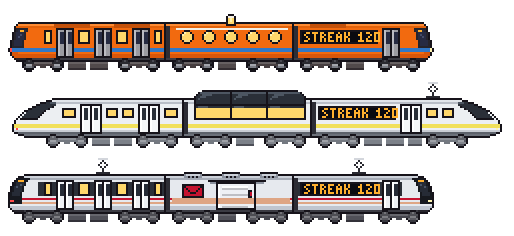

# Usage guide

[git-trains](../README.md)

## What each part means

| Your activity | On the train |
| --- | --- |
| Contributions in the last year | **Cars**, from 1 to 6 (50 / 200 / 500 / 1000 / 2000) |
| Top language | A **stripe** in that language's official GitHub color |
| Current streak | The LED sign **"STREAK 12"** and the lit windows (30 days lights them all) |
| What you did yesterday | **0**: stopped with its doors open · **1-3**: slow · **4-9**: normal · **10+**: fast, with sparks and speed lines |
| Same activity | A **signal** by the track: red (0), amber (a little) or green (normal or a lot) |
| Your username | The **station sign**, and a procedural **city of your own**: no two users get the same skyline |

Your streak doesn't break first thing in the morning: if there's no activity yet today, it counts from yesterday.
## Unlockable cars

Some milestones add a special car to your train, right behind the cab. Only one is shown, the rarest you've earned.



| You earn | Car | What it looks like |
| --- | --- | --- |
| 500+ pull requests | **Mail car** | No windows: a sliding cargo door, an envelope, and a stripe in your top language's color |
| A 100-day streak | **Dining car** | Round windows that glow, and a little lamp on the roof |
| 100+ stars on your repositories | **Observation car** | A raised glass roof and panoramic windows |

The cars are drawn in the palette of whichever train they join, and the image title gets a line saying which one you earned. The streak is your current one, so the dining car leaves if the streak breaks. A special car counts as one more car: on a 6-car train it takes the place of the last regular car so the train still fits the scene.

They need your profile numbers (stars and pull requests), which is one more API request per run. If it fails, the Action logs a `::notice::` and draws the train without it. Set `unlocks: false` to turn them off.
## Calendar mode

Set `calendar: true` to write a contribution calendar alongside the train. A mini version of your train snakes through the weeks, eating contribution cells and growing to the same length as the scene train. It works with custom and steam trains too. Its stripe, windows and speed follow your activity; the caption shows your contributions and streak. `language` and `label` also apply. The calendar follows the selected theme and parks the train when reduced motion is requested.


```yaml
      - uses: Cracksmity/git-trains@3b431f93872507bc915be9f20e8b84ed104fdbe8 # v1.1.2
        with:
          calendar: true
```

With the default `theme: both`, add this to your README:

```html
<picture>
  <source media="(prefers-color-scheme: dark)" srcset="../dist/train-calendar-dark.svg">
  
</picture>
```

The Action also writes `train-calendar.svg`. With a single theme, it writes only that calendar file. See also the [steam example](example-calendar-steam.svg).
## Year in review

Set `year-in-review: true` to write a poster of one calendar year of your activity, drawn as a train journey.



What's on it:

- **Your year in four numbers:** contributions, active days, the longest streak (with its dates) and the busiest day.
- **A route map:** a rail line with one station per month, as tall as that month was busy (the busiest month flies a flag). Your train runs the line, the same model as the scene (`train`: a catalog model, your own JSON or a steam locomotive) with as many cars as that year's total earns, in your top language's stripe. It stops at every station for as long as the month was busy and goes through the months with nothing. With reduced motion it stands at the last station.
- **The busiest month and your top languages** of that year: the primary languages of the repositories you committed to, ranked by commits (`exclude-languages` applies; up to four).
- **The special car** if you earned one (see [Unlockable cars](#unlockable-cars)), riding behind the cab with a line saying which. For the poster it is earned on that year: its longest streak, plus your profile's stars and pull requests.

```yaml
      - uses: Cracksmity/git-trains@3b431f93872507bc915be9f20e8b84ed104fdbe8 # v1.1.2
        with:
          year-in-review: true
          review-year: 2025 # optional
```

**Which year?** `review-year` takes a year from 2008 to the current one. Left empty it is the **current year so far**, except in **January**, when the new year has barely begun and the poster shows the **year that just ended**. (UTC, like everything else here.) A year in progress covers the days up to the day the Action runs.

It follows `theme`, `language` and `border`, and takes the same five colors as the cards (`color-background`, `color-title`, `color-icon`, `color-text`, `color-ring`): the background, the headings and big numbers, the rails and icons, the text, and the stations. With the default `theme: both` add this to your README:

```html
<picture>
  <source media="(prefers-color-scheme: dark)" srcset="../dist/year-in-review-dark.svg">
  
</picture>
```

The Action also writes `year-in-review.svg` (automatic); with a single theme it writes only that file. It makes one extra API request (plus the profile request the unlockable cars already use). If it fails, the Action logs a `::warning::` and still writes everything else. [In Spanish](example-year-in-review-es.svg) with `language: es`.
## Seasons and holidays

The scene follows the calendar, so your profile feels alive all year. On the day the Action runs (UTC) it adds a few pixels of decoration on their own layers, behind the train, and still stops with reduced motion:

| When | What the scene wears |
| --- | --- |
| Winter (Dec – Feb) | light snow falling, snow on the roofs and on the ground |
| Spring (Mar – May) | a few pink petals drifting |
| Summer (Jun – Aug) | nothing: the plain scene |
| Autumn (Sep – Nov) | orange leaves |
| Oct 1 – 30 · Hacktoberfest | a small pumpkin by the signal |
| Oct 31 – Nov 2 · Día de Muertos | marigold papel picado strung along the line |
| Dec 15 – Jan 6 · Christmas | blinking lights on the wire |
| Dec 31 – Jan 1 · New Year | fireworks behind the city |

| | |
| --- | --- |
| <br><sub>Winter (Jan 20)</sub> | <br><sub>Spring (Apr 10)</sub> |
| <br><sub>Día de Muertos (Nov 1)</sub> | <br><sub>Christmas (Dec 20)</sub> |

A holiday wins over the season, and when two holidays overlap the shorter one wins (New Year over Christmas, Día de Muertos over Hacktoberfest). The seasons are the northern ones: set `hemisphere: south` to flip them (spring starts in September; holidays keep their dates), or `seasons: false` to keep the scene plain all year. A day with no decoration draws exactly the same SVG as before.

To see any day, use the date picker in the **[playground](https://cracksmity.github.io/git-trains/preview/)**. In code, `buildSpec(stats, { date: '2026-12-24', hemisphere: 'north' })` dresses the scene for that day (`date` is a `Date` or a `YYYY-MM-DD` string).
## Profile cards

With `cards: both` the Action also writes `card-stats.svg` and `card-languages.svg`: a stats card (stars, commits in the last year, PRs, issues and repos you contributed to, with a rank ring) and a card with your most used languages. They follow the layout of the [github-readme-stats](https://github.com/anuraghazra/github-readme-stats) cards, but they're **generated inside your workflow** with this project's own code: no external service that can go down, and no third-party actions.

 

If the stats query fails (for example, an API limit), the Action logs a `::warning::` and keeps going: the train is still generated. The rank is an approximation (a weighted mix of commits, PRs, issues, reviews, stars and followers).

### Departures board

`cards: departures` writes `card-departures.svg`: a split-flap station board with your six most recently pushed public repositories. `cards` takes a list, so `cards: stats, departures` writes both and `cards: both, departures` writes all three (`both` still means stats and languages).



| Column | What it shows |
| --- | --- |
| TIME | When you last pushed: `HH:MM` (UTC) if it was today, otherwise the date |
| DESTINATION | The repository name |
| PLATFORM | Its main language |
| STATUS | `BOARDING` (pushed today), `ON TIME` (last 7 days), `DELAYED` (last 30 days) or `DEPARTED` (older) |

The characters flip into place when the card loads, with CSS only; it respects `prefers-reduced-motion`. With `language: es` it reads `SALIDAS`, `HORA`, `DESTINO`, `ANDÉN`, `ESTADO` and `ABORDANDO`, `A TIEMPO`, `RETRASADO`, `SALIÓ`. It takes the same `color-*` and `border` inputs as the other cards, but starts from a board of its own: `color-background` is the panel, `color-title` the title bar, headings and `BOARDING`, `color-text` the flap characters, `color-icon` the `ON TIME` status and the little train, and `color-ring` the `DELAYED` status. Forks aren't listed, and neither is your profile repository (the one named like you): the workflow that draws these images commits to it every day, so it would always be first.
## In a repository README

A train isn't only for profiles. With `repo: owner/name` it describes **a repository**, so any project can have a living train in its README: it grows with the commits of the last year, wears the color of the repository's main language and runs as fast as the repository moved yesterday.

<picture>
  <source media="(prefers-color-scheme: dark)" srcset="https://raw.githubusercontent.com/Cracksmity/git-trains/output/train-repo-dark.svg">
  
</picture>
<picture>
  <source media="(prefers-color-scheme: dark)" srcset="https://raw.githubusercontent.com/Cracksmity/git-trains/output/train-repo-calendar-dark.svg">
  
</picture>

<sub>That's **this** repository, `Cracksmity/git-trains`, in repo mode: [the same workflow](../.github/workflows/train.yml) that draws the author's train above draws it too, every morning.</sub>

```yaml
      - uses: actions/checkout@fbc6f3992d24b796d5a048ff273f7fcc4a7b6c09 # v5
      - uses: Cracksmity/git-trains@3b431f93872507bc915be9f20e8b84ed104fdbe8 # v1.1.2
        with:
          repo: ${{ github.repository }} # or any public owner/name, for example facebook/react
          output-dir: out
          calendar: true
          cards: stats, departures
```

The default `GITHUB_TOKEN` is enough: it reads any public repository and the one the workflow runs in. A complete workflow that publishes the images to a branch of their own (so the repository's history doesn't fill with image commits) is in [examples/workflow-repo.yml](../examples/workflow-repo.yml). Then, in the README:

```html
<picture>
  <source media="(prefers-color-scheme: dark)" srcset="https://raw.githubusercontent.com/OWNER/REPO/train/train-repo-dark.svg">
  
</picture>
```

Everything else works as it does for a profile (`mode: multi`, `train`, `skyline`, `seasons`, `language`, `exclude-languages`...). What changes:

| | A profile | A repository |
| --- | --- | --- |
| Cars, speed and streak | Your contributions | The commits on the default branch (last year), the days with commits, and yesterday's |
| Stripe and caption | The language of your repositories | The repository's own languages |
| Station sign and LED sign | Your username | The repository name |
| The city | Seeded with your username | Seeded with `owner/name`: the same repository name under another owner is another city |
| `calendar: true` | Contribution calendar | Commit calendar, captioned `... COMMITS` |
| `cards: stats` | Stars, commits, PRs, issues, repos contributed to | Stars, forks, commits (last year), open issues and contributors, with the same rank ring |
| `cards: departures` | Your recently pushed repositories | The latest releases, with tags that have no release behind them |
| Unlockable cars | Your streak, stars and PRs | The repository's own: its commit streak, stars and pull requests |
| Files | `train*.svg`, `card-*.svg` | `train-repo*.svg`, `card-repo-*.svg`: one workflow can draw a profile and a repository into the same folder |

 

On the departures board the TIME column is when the release was published, DESTINATION is its tag, PLATFORM says `RELEASE`, `PRERELEASE` or `TAG`, and STATUS reads like it does for repositories: `BOARDING` is a release made today, `DEPARTED` one from over a month ago. A repository with no releases and no tags gets an empty board. The cards show sample numbers here; the stats card's rank is the profile one, read for a project (forks count where followers do).

**Where the numbers come from.** The commit activity comes from GitHub's statistics endpoint (`/stats/commit_activity`), which answers `202` while it is being computed, usually the first time anyone asks. The Action asks again a few times, with a pause; if the numbers never come, it counts the commits one by one (the last 1,000 at most) and logs a notice, so the train is still drawn. Only the default branch counts, and bots count as GitHub counts them. The languages come from `/languages` and the other numbers from one GraphQL query, so a run makes about five requests. If the cards can't be read the Action logs a `::warning::` and keeps the train, as it does for profiles.
## How it works

- No dependencies and no build step: plain JavaScript that runs directly on the runner (Node 24).
- Every train is drawn **in code on a shared grid** (64 px cars with 2 or 3 doors per side, bogies with two 7 px disc wheels, frame and axle boxes, painted with each model's palette), not from images. The layers (body, doors, wheels, sign, sparks, smoke) are animated separately.
- The result is a ~40 KB SVG (~75 KB in `multi` mode) with CSS: the train moves **1 px at a time** (`steps()`), the wheel marks alternate between two frames, the clouds drift and the stars twinkle in the dark theme. It respects `prefers-reduced-motion`.
- The LED sign uses its own 3×5 pixel font; the train uses no SVG text, so it doesn't depend on fonts.
- GitHub's API is retried with backoff when it hiccups (502s are common on heavy GraphQL queries).
